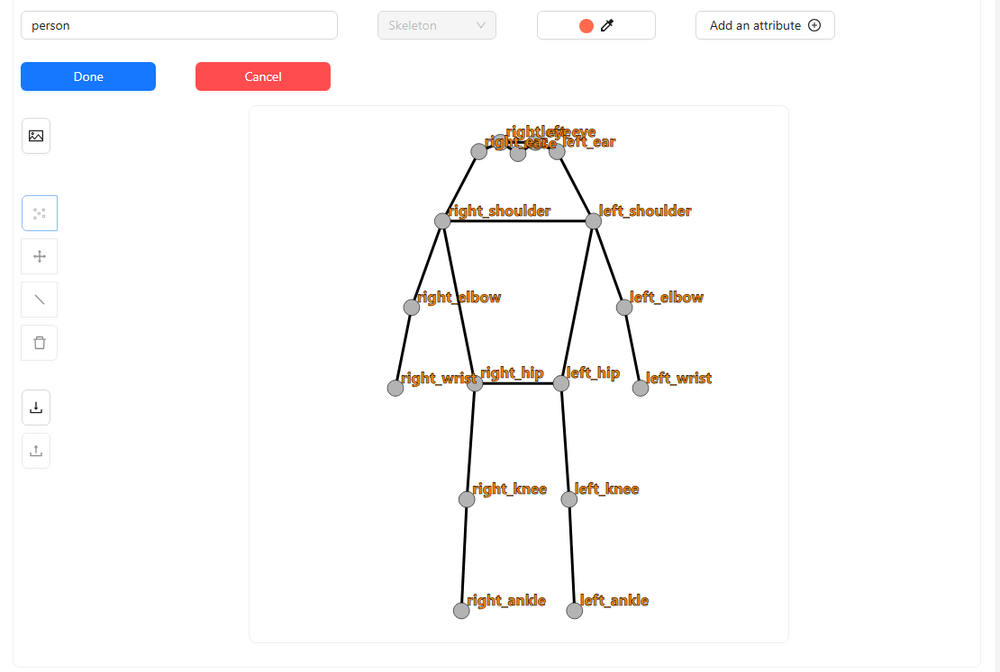
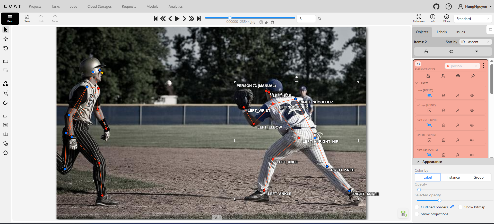
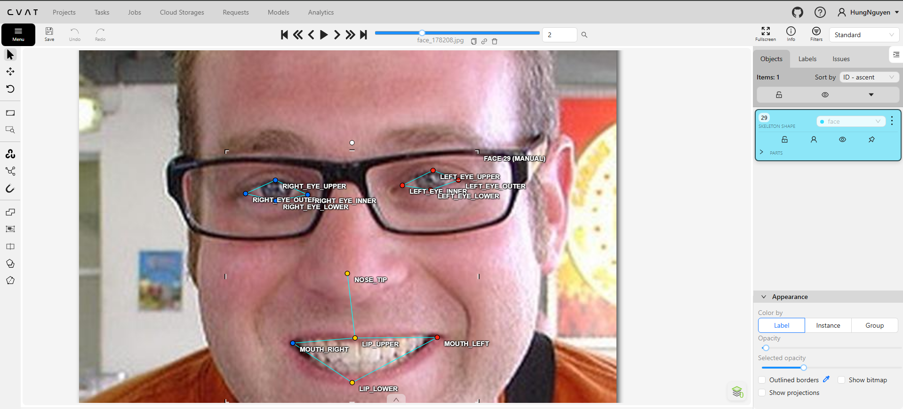
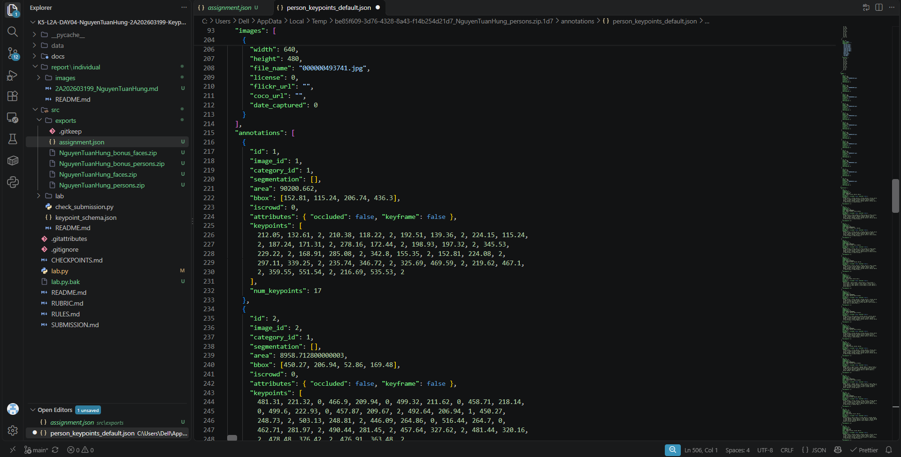

# Báo cáo cá nhân — Nguyen Tuan Hung

Dữ liệu: 12 ảnh người và 8 ảnh mặt được chọn từ bộ ảnh lab theo MSSV. Nguồn ảnh gốc theo `src/lab/NGUON_ANH.md` là COCO 2017.

## 0. Thông tin học viên

- Họ tên: Nguyen Tuan Hung
- MSSV: 2A202603199
- Email: hungnn91296@gmail.com
- Link repository: https://github.com/hungnguyen67/K5-L2A-DAY04-NguyenTuanHung-2A202603199-KeypointPose
- Tên đăng nhập CVAT trong `assignment.json`: HungNguyen
- Phiên bản CVAT (API `http://localhost:8080/api/server/about`): 2.74.1
- Máy: Windows · RAM vật lý: 15.7 GB · CVAT: đầy đủ (các dịch vụ tùy chọn đều đang chạy)
- Bộ ảnh (`src/exports/assignment.json`): Có; pool `d04-k5-v2`; 12 ảnh người, 8 ảnh mặt và có bộ bonus
- Giờ bắt đầu: 16:00, 12/11/2026 (GMT+7)
- Giờ kết thúc: 19:30, 12/11/2026 (GMT+7)

## 1. Kiểm tra label (CP0)

| Label    | Kiểu     | Số điểm | Tên điểm đúng bảng của lab?               | Đúng thứ tự?                     | Số cạnh |
| -------- | -------- | ------: | ----------------------------------------- | -------------------------------- | ------: |
| `person` | Skeleton |      17 | Có, tự kiểm cấu trúc export không báo lỗi | Có, không có cảnh báo sai thứ tự |      19 |
| `face`   | Skeleton |      13 | Có, tự kiểm cấu trúc export không báo lỗi | Có, không có cảnh báo sai thứ tự |      13 |

Mẫu `person` dựng theo người quay mặt về camera (các điểm `left_*` nằm bên phải khung mẫu)? Có theo mô tả schema và ảnh chụp label.

Cách đổi cờ `occluded` / `outside` cho **một điểm** trên phiên bản CVAT này (một câu):

Chọn điểm (part) cần đổi trong bảng `Objects`, rồi bấm biểu tượng trạng thái ngay trên dòng của điểm đó.

## 2. Số lượng đã gán và thời gian (CP1, CP2)

| Nhóm ảnh   | Số ảnh | Số skeleton đã gán | Số người dưới 60 px (không gán) | Số poster / gương / màn hình bỏ qua | Thời gian ước tính (phút) |
| ---------- | -----: | -----------------: | ------------------------------: | ----------------------------------: | ------------------------: |
| `easy`     |      5 |                  5 |                               0 |                                   0 |                        25 |
| `occluded` |      3 |                  5 |                               0 |                                   0 |                        21 |
| `back`     |      2 |                  4 |                               1 |                                   0 |                        16 |
| `small`    |      1 |                  0 |                               2 |                                   0 |                         8 |
| `crowd`    |      1 |                  3 |                               0 |                                   0 |                        14 |
| `faces`    |      8 |                  8 |                               — |                                   0 |                        30 |

ZIP export hiện tại có 17 skeleton người; `000000189365.jpg` có 2 skeleton sau khi thêm người nền. Người nền nhỏ trong `000000123544.jpg` thấp hơn ngưỡng 60 px nên không thêm skeleton và được tính vào cột người dưới ngưỡng.

- Số ảnh người đã xong ở mốc phút 105: Ước tính 8 / 10
- Thời gian CP (ước tính theo lịch lab, không phải log): CP1 90 phút · CP2 30 phút · CP3 20 phút
- Ảnh tốn thời gian nhất: `000000123544.jpg`, người bên trái. Lý do mô tả theo ảnh: người nằm sát mép trái khung hình và ở tư thế chạy nghiêng, nên việc xác định vị trí các khớp tay/chân và trái/phải khó hơn.

Rà ảnh `small` (640 × 428 px): có 2 bóng người rõ ràng dưới 60 px; một vùng mờ cạnh đồng hồ chưa đủ rõ để tính thêm. Người ngoài cùng bên phải cũng mờ/nhỏ; ngưỡng 60 px chưa xác định được nên chưa thể kết luận có thiếu skeleton. Số poster/gương/màn hình là 0 theo ảnh được rà. Thời gian nhóm ước tính theo nhịp trong `CHECKPOINTS.md` (easy 5, occluded 7, back 8, small 8, crowd 14 phút/ảnh; faces 30 phút tổng), không phải thời gian thực tế đo được.

## 3. Bảng ca khó (CP1, CP2)

Mỗi điểm bạn phân vân một dòng, nhất là phân vân giữa `v = 1` và `v = 0`, hoặc không chắc hướng người.

| Ảnh                | Người / mặt | Điểm            |       Cờ đã chọn | Phân vân giữa                                                                                                | Lý do chọn       |
| ------------------ | ----------- | --------------- | ---------------: | ------------------------------------------------------------------------------------------------------------ | ---------------- |
| `000000292999.jpg` | person #1   | Vai trái (`left_shoulder`) | `v = 1` | Phân vân giữa `v = 1` (bị che khuất nhưng ước lượng được) và `v = 0` (không xác định được vị trí). | Vai trái bị che một phần nhưng vị trí ước lượng được từ tư thế và liên kết skeleton; điểm nằm trong ảnh nên chọn `v = 1`, không phải `v = 0`. |
| `000000332273.jpg` | person #3   | ankle trái/phải | `v = 2` cả hai | Cặp `left_ankle` / `right_ankle` có bị gán ngược trái/phải không? Không phân vân về visibility. | Cả hai cổ chân nhìn thấy; checker chỉ cảnh báo heuristic về trái/phải. Chưa đổi nhãn nếu chưa lần theo từng chân từ hông → gối → cổ chân để xác nhận. |
| `000000054909.jpg` | person #2   | Vai phải (`right_shoulder`) | `v = 1` | Phân vân giữa `v = 1` (bị che nhưng ước lượng được) và `v = 0` (không xác định được vị trí). | Vai bị ô che khuất một phần nhưng vị trí ước lượng được theo thân người; điểm nằm trong ảnh nên chọn `v = 1`. |

## 4. Bảng tự review (CP3)

Đi từ ảnh cuối về ảnh đầu. 5 ảnh người (ít nhất 2 ảnh `back` hoặc `crowd`) và 3 ảnh mặt. Ít nhất 8 dòng, kể cả dòng `ok`. Ghi lỗi trước, sửa sau.

Mã lỗi dùng đúng một trong: `lr_swap`, `vis_flag`, `position`, `missing`, `extra`, `ok`.

`lr_swap` nghĩa là nghi ngờ nhãn trái/phải bị đảo; đây là cảnh báo cần kiểm tra, chưa khẳng định annotation sai.

| Ảnh                | Người / mặt | Điểm          | Mã lỗi     | Ghi chú                                                                                                       | Tình trạng sửa trên CVAT |
| ------------------ | ----------- | ------------- | ---------- | ------------------------------------------------------------------------------------------------------------- | ------------------------ |
| `000000332273.jpg` | person #3   | Cặp mắt cá    | `ok`       | Bạn xác nhận cặp cổ chân trái/phải đã gán đúng; cảnh báo checker do tư thế một chân trụ/một chân co, không cần đổi nhãn. | Đã xác nhận đúng; không cần sửa |
| `000000123544.jpg` | person nền  | —             | `ok`       | Người nền nhỏ dưới ngưỡng 60 px; theo quy tắc lab không cần gán skeleton.                                     | Không cần sửa            |
| `000000189365.jpg` | person nền  | Toàn skeleton | `missing`  | Trước khi sửa, người mặc áo đỏ phía sau vận động viên chưa có skeleton.                                        | Đã sửa: thêm 1 skeleton |
| `000000090646.jpg` | person #1   | —             | `ok`       | Người thật đã gán; mannequin không bị gán nhầm. Không thấy lệch vị trí lớn trong ảnh chụp.                    | Không cần sửa            |
| `000000292999.jpg` | person #1   | Cặp khuỷu tay | `ok`       | Bạn xác nhận nhãn trái/phải khuỷu tay đúng; hai tay giao nhau khi cầm gậy nhưng không cần sửa.                | Không cần sửa            |
| `face_178208.jpg`  | face #1     | —             | `ok`       | 13 điểm nhìn chung nằm gần mắt, mũi và miệng; kính không che các điểm chính.                                  | Không cần sửa            |
| `face_264124.jpg`  | face #1     | `lip_lower`   | `position` | Trước khi sửa, điểm môi dưới nằm thấp về phía cằm/râu, không sát viền môi dưới.                               | Đã sửa: chỉnh vị trí điểm môi dưới |
| `face_145751.jpg`  | face #1     | `lip_lower`   | `position` | Trước khi sửa, điểm môi dưới nằm thấp hơn viền môi, gần vùng cằm.                                             | Đã sửa: chỉnh vị trí điểm môi dưới |

Tổng hợp số lỗi theo mã:

| `lr_swap` | `vis_flag` | `position` | `missing` | `extra` | `ok` |
| --------: | ---------: | ---------: | --------: | ------: | ---: |
|         0 |          0 |          2 |         1 |       0 |    5 |

Điểm còn phân vân giữa `v = 1` và `v = 0` (ghi cả hai lựa chọn và lý do chọn):

Các điểm đã ghi phân vân giữa `v = 1` và `v = 0` ở mục 3: `000000292999.jpg` — `left_shoulder` và `000000054909.jpg` — `right_shoulder`. Cả hai đang chọn `v = 1` vì bị che khuất nhưng vị trí vẫn ước lượng được; mục CP3 này không ghi thêm trường hợp visibility nào khác.

## 5. Kiểm file xuất và kết quả tự kiểm (CP4)

Tự kiểm tay trong file JSON:

| File                         | Người / mặt kiểm (ảnh, thứ tự)  | Số phần tử `keypoints` | Điểm `outside` ra `v = 0`, `occluded` ra `v = 1`?          | `num_keypoints` khớp? |
| ---------------------------- | ------------------------------- | ---------------------: | ---------------------------------------------------------- | --------------------- |
| `NguyenTuanHung_persons.zip` | `000000027565.jpg`, skeleton #1 |                     51 | Mọi điểm `v = 2`, không có điểm `outside` / `occluded` để đối chiếu | `num_keypoints = 17`; khớp 17 điểm `v > 0` |
| `NguyenTuanHung_persons.zip` | `000000054909.jpg`, skeleton #1 |                     51 | JSON có 1 điểm `v = 1`, 7 điểm `v = 0`; theo quy ước COCO/CVAT, lần lượt là `occluded` / `outside` | `num_keypoints = 10`; khớp 10 điểm `v > 0` |
| `NguyenTuanHung_faces.zip`   | `face_145751.jpg`, skeleton #1  |                     39 | Mọi điểm `v = 2`, không có điểm `outside` / `occluded` để đối chiếu | `num_keypoints = 13`; khớp 13 điểm `v > 0` |

Sau khi xuất, CVAT ghi `occluded` thành `v = 1` và `outside` thành `v = 0`. Tọa độ của điểm `outside` trong file là tọa độ cũ, không phải `0, 0`.

Hai job đã chuyển sang completed trên CVAT? Có

Dán phần **TÓM TẮT** in ra từ `src/check_submission.py`:

```text
- File person: NguyenTuanHung_persons.zip
  Số ảnh: 12 · số skeleton `person`: 17 · mỗi annotation 51 số
  Skeleton theo ảnh: 000000027565=1, 000000054909=2, 000000090646=1, 000000123544=2, 000000189365=2, 000000292999=1, 000000323705=0, 000000332273=3, 000000336477=1, 000000360811=2, 000000429594=1, 000000493741=1
  Cờ v: v=2 197 (68%) · v=1 24 (8%) · v=0 68 (24%)
  num_keypoints trung bình: 13.0
- File face: NguyenTuanHung_faces.zip
  Số ảnh: 8 · số skeleton `face`: 8 · mỗi annotation 39 số
  Skeleton theo ảnh: face_145751=1, face_155465=1, face_178208=1, face_185015=1, face_264124=1, face_300399=1, face_309728=1, face_333134=1
  Cờ v: v=2 95 (91%) · v=1 1 (1%) · v=0 8 (8%)
  num_keypoints trung bình: 12.0
- Ghi chú: 76 điểm v = 0 vẫn mang tọa độ cũ (CVAT 2.x xuất như vậy; chuẩn COCO ghi 0, 0). Không phải lỗi: điểm v = 0 bị bỏ qua khi huấn luyện và khi chấm.
- Số [LỖI]: 0 · số [CẢNH BÁO]: 3
Kết quả: ĐẠT (đọc lại từng cảnh báo ở trên)
```

Các `[CẢNH BÁO]` từ lần kiểm hiện tại và tình trạng:

- `000000292999.jpg` #1: cặp elbow có thể ngược trái/phải hoặc tay bắt chéo; bạn xác nhận đã gán đúng, chưa cần sửa.
- `000000323705.jpg`: không có skeleton `person`; cần xác nhận không có người nào đạt ngưỡng 60 px.
- `000000332273.jpg` #2: cặp ankle có thể ngược trái/phải hoặc chân bắt chéo; đây là person #2, khác person #3 đã xác nhận đúng ở mục 4.

## 6. Ảnh chụp màn hình

1. Label `person` trong label constructor (đủ 17 điểm có tên; ảnh chụp hiện có):

   

2. Ảnh CVAT hiện có là `000000123544.jpg`; chưa xác minh rõ đây là người quay lưng hoặc cờ visibility:

   

3. Ảnh mặt `face_178208.jpg` đã gán 13 điểm, phóng to vùng mắt:

   

4. Ảnh JSON export hiện có hiển thị annotation người trong file xuất:

   

Nguồn: ảnh label và JSON là ảnh giao diện/annotation CVAT; ảnh người `000000123544.jpg` và ảnh mặt `face_178208.jpg` thuộc bộ ảnh COCO 2017 theo `src/lab/NGUON_ANH.md`.

## 7. Tự đánh giá

1. Lỗi bạn mắc nhiều nhất hôm nay, và cách bạn sẽ tránh ở dự án thật:

   Lỗi dễ mắc là bỏ sót người nền đủ ngưỡng 60 px như ảnh `000000189365.jpg`. Để tránh lặp lại ở dự án thật, rà toàn ảnh, đếm người đủ ngưỡng rồi mới xuất.

2. Một quy tắc bạn đề xuất thêm vào guideline (kèm ảnh ví dụ nếu có):

   Chưa có đề xuất.

3. Nhãn của bạn đi vào model ở đâu? Chọn một lỗi bạn đã sửa và nói nó sẽ làm model học sai thế nào (heatmap, trọng số trong loss, hay bước lật ảnh):

   Đã bổ sung skeleton người nền bị bỏ sót ở `000000189365.jpg`. Nếu thiếu skeleton, các khớp của người đó không có heatmap mục tiêu, khiến model thiếu giám sát cho người nền/tư thế này và dễ bỏ sót trường hợp tương tự.

## 8. Khó khăn và lỗi kỹ thuật

Không có khó khăn kỹ thuật nào được học viên báo cáo. Checker chạy thành công, không có lỗi định dạng (0 lỗi) và có 3 cảnh báo annotation: cặp elbow ở `000000292999.jpg` đã được học viên xác nhận đúng; ảnh `000000323705.jpg` chưa có skeleton và cần xác nhận người trong ảnh có ai đạt ngưỡng 60 px không; cặp ankle của person #2 trong `000000332273.jpg` còn cần kiểm tra trái/phải. Đây là cảnh báo rà soát nhãn, không phải lỗi kỹ thuật của chương trình.

## Bonus (nếu làm)

### B1 — 3 ảnh người khó thêm

| Ảnh                | Số skeleton | Số người dưới 60 px | Ca khó nhất      |
| ------------------ | ----------: | ------------------: | ---------------- |
| `000000104800.jpg` |           2 |                  0 | Person #2, người phụ nữ cạnh xe đạp: tay/chân bị xe đạp và giỏ che một phần. |
| `000000373426.jpg` |           3 |                  0 | Person #2, catcher: tư thế ngồi xổm và chồng lấn với batter. |
| `000000565600.jpg` |           3 |                  0 | Person #1, người áo sọc: tay/vợt chồng lấn với người áo trắng ở tiền cảnh. |

Số người dưới 60 px được rà trực quan trên ba ảnh; không thấy người thật chưa gán nào dưới ngưỡng. Người trong ảnh quảng cáo ở `000000104800.jpg` không tính vì không phải người thật trong cảnh.

Kết quả `src/check_submission.py` cho `HoVaTen_bonus_persons.zip`:

```text
- File person: NguyenTuanHung_bonus_persons.zip
  Số ảnh: 3 · số skeleton `person`: 8 · mỗi annotation 51 số
  Skeleton theo ảnh: 000000104800=2, 000000373426=3, 000000565600=3
  Cờ v: v=2 84 (62%) · v=1 12 (9%) · v=0 40 (29%)
  num_keypoints trung bình: 12.0
- File face: NguyenTuanHung_bonus_faces.zip
  Số ảnh: 5 · số skeleton `face`: 5 · mỗi annotation 39 số
  Skeleton theo ảnh: face_280788=1, face_344941=1, face_45276=1, face_494518=1, face_507166=1
  Cờ v: v=2 65 (100%) · v=1 0 (0%) · v=0 0 (0%)
  num_keypoints trung bình: 13.0
- Ghi chú: 40 điểm v = 0 vẫn mang tọa độ cũ (CVAT 2.x xuất như vậy; chuẩn COCO ghi 0, 0). Không phải lỗi: điểm v = 0 bị bỏ qua khi huấn luyện và khi chấm.
- Số [LỖI]: 0 · số [CẢNH BÁO]: 0
Kết quả: ĐẠT
```

### B2 — 5 ảnh khuôn mặt đen trắng / hồng ngoại

Ảnh không màu khó hơn ở điểm nào? Kính râm trên ảnh hồng ngoại có còn là `v = 1` không?

Trong 5 ảnh bonus đã rà, ảnh đen trắng làm khó hơn ở chỗ phải dựa vào độ sáng, bóng và đường viền để xác định mí mắt, khóe mắt và môi thay vì dựa vào màu. Không thấy ảnh hồng ngoại hoặc kính râm trong bộ này. Với ảnh hồng ngoại, nếu kính vẫn che mắt nhưng vị trí mắt còn ước lượng được thì dùng `v = 1`; nếu nhìn thấy mắt thì `v = 2`, còn nếu không xác định được vị trí thì `v = 0`.

### B3 — Model so với nhãn của tôi (không tính điểm)

- Demo tham khảo: MediaPipe Studio — Pose Landmarker (chưa chạy inference thực tế)
- Ảnh tham chiếu: `000000054909.jpg` (người quay lưng), `000000189365.jpg` (người nền/bị che); chưa chạy model trên các ảnh này

Các câu trả lời dưới đây là nhận xét khái quát theo bài lab, không phải kết quả chạy model trên ảnh của mình.

1. Model có trả điểm cho khớp bị che, hay khớp ngoài ảnh không? Confidence ở các điểm đó thế nào?

   Model pose thường vẫn có thể dự đoán tọa độ khớp bị che nếu suy luận được, nhưng confidence có thể thấp hơn. Khớp ngoài ảnh có thể không có điểm dự đoán đáng tin cậy; `v = 0` là cờ bỏ qua điểm trong nhãn, không phải confidence của model. Chưa có kết quả/confidence thực tế từ ảnh của mình.

2. Với người quay lưng, model có đổi trái/phải không?

   Với người quay lưng, model có thể nhầm trái/phải, nhất là khi tay/chân bắt chéo. Bài của mình có ảnh người quay lưng để đối chiếu, nhưng chưa có kết quả inference nên chưa kết luận model có đổi bên hay không.

3. Bộ điểm của model có giống 17 điểm COCO không?

   Nhãn người trong bài của mình dùng 17 điểm COCO. Bộ điểm đầu ra phụ thuộc model: có model xuất đúng 17 điểm COCO, model khác có thể xuất số điểm/tên khác và cần ánh xạ trước khi so sánh. Chưa có model cụ thể để xác nhận bộ điểm đầu ra.

## 9. Tài liệu tham khảo và công cụ AI đã dùng

Nguồn ảnh và cấu trúc keypoint được mô tả trong `src/lab/NGUON_ANH.md` và `src/keypoint_schema.json`. Có dùng trợ lý AI để kiểm tra cấu trúc repo, đối chiếu assignment và file ZIP/JSON export, chạy `src/check_submission.py`, rà soát 5 ảnh người và 3 ảnh mặt trong mục 4, cùng các ảnh bonus, rồi cập nhật báo cáo theo dữ liệu kiểm tra và thông tin học viên xác nhận. Các cảnh báo/nhận xét về nhãn được xem là gợi ý để học viên kiểm tra trên CVAT; học viên tự thao tác sửa annotation. AI không gán nhãn hoặc sửa annotation trên CVAT.
